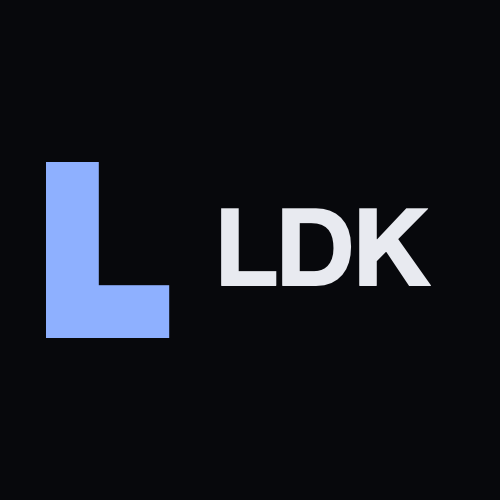

# Litecoin Dev Kit

  

  

    <strong>Build Litecoin wallets that can send privately.</strong>
  

  

    A Litecoin port of <a href="https://bitcoindevkit.org">Bitcoin Dev Kit</a>. Privacy is MWEB: peg in, send on the extension block, peg out.
  

  

    
    
    
  

  <h4>
    <a href="https://litecoindevkit.com">litecoindevkit.com</a>
     · 
    <a href="https://github.com/LitecoinDevKit/ldk-wallet">Desktop wallet</a>
     · 
    <a href="./docs/ADOPTION.md">Adoption guide</a>
  </h4>

> **Litecoin Dev Kit (LDK).** Every crate keeps its `bdk_*` name and its
> `bitcoin::` paths, but the `bitcoin` dependency is aliased to the [`litecoin`] crate, so those
> paths resolve to Litecoin types. Upstream owns the `bdk_*` names on crates.io, so consume this
> fork by git revision.
>
> **Integrating a wallet?** Start with **[docs/ADOPTION.md](./docs/ADOPTION.md)** (Rust vs FFI,
> blessed pins, maps-first MWEB API). Prove it with
> [docs/DOGFOOD_CHECKLIST.md](./docs/DOGFOOD_CHECKLIST.md). Port internals: [PORTING.md](./PORTING.md).
> Show Core / ltcsuite how we tested: [docs/TEST_EVIDENCE.md](./docs/TEST_EVIDENCE.md).
> E2E recipes: [docs/LITECOIN_E2E.md](./docs/LITECOIN_E2E.md). Leaving embedded mwebd:
> [docs/MIGRATE_FROM_MWEBD.md](./docs/MIGRATE_FROM_MWEBD.md) **first**.
>
> Transparent wallets (legacy and SegWit) sync via Electrum/Esplora or
> [`bdk_bitcoind_rpc`](./crates/bitcoind_rpc) (vendored Litecoin `bitcoincore-rpc` 0.19). MWEB is
> spendable through [`bdk_mweb`](./crates/mweb) and
> [`bdk_wallet`](https://github.com/LitecoinDevKit/bdk_wallet) `mweb` feature. Regtest uses
> `litecoind` (+ optional `electrs-ltc`).

## About

These libraries are the Litecoin Dev Kit components for descriptor-based wallets and other applications. They are a port of [Bitcoin Dev Kit](https://bitcoindevkit.org), built on the [`litecoin`] crate and [`rust-miniscript`].

## Architecture

The workspace in this repository contains several crates in the `/crates` directory:

| Sub-Directory | Description |
|---------------|-------------|
| [`chain`](./crates/chain) | Tools for storing and indexing chain data. |
| [`core`](./crates/core) | A collection of core structures used by [`bdk_chain`], [`bdk_wallet`], and this repo's chain data source crates. |
| [`esplora`](./crates/esplora) | Extends the [`esplora-client`] crate with methods to fetch chain data from an esplora HTTP server in the form that [`bdk_chain`] and `Wallet` can consume. |
| [`electrum`](./crates/electrum) | Extends the [`electrum-client`] crate with methods to fetch chain data from an electrum server in the form that [`bdk_chain`] and `Wallet` can consume. |
| [`bitcoind_rpc`](./crates/bitcoind_rpc) | Extends Litecoin-aliased [`bitcoincore-rpc`] (vendored under `vendor/bitcoincore-rpc`) for emitting chain data from `litecoind` RPC. |
| [`file_store`](./crates/file_store) | Persistence backend for storing chain data in a single file. Intended for testing and development purposes, not for production. |
| [`mweb`](./crates/mweb) | Litecoin MWEB: stealth keys, receive scan, coin DB, peg-in/out and MWEB→MWEB tx authoring (`bdk_mweb`). |

The [`bdk_wallet`] repository and crate contains a higher level `Wallet` type that depends on the above lower-level mechanism crates.

[`litecoin`]: https://github.com/LitecoinDevKit/rust-litecoin
[`rust-miniscript`]: https://github.com/LitecoinDevKit/rust-miniscript
[`esplora-client`]: https://github.com/IndigoNakamoto/rust-esplora-client
[`electrum-client`]: https://github.com/LitecoinDevKit/rust-electrum-client
[`bitcoincore-rpc`]: ./vendor/bitcoincore-rpc
[`bdk_chain`]: ./crates/chain
[`bdk_wallet`]: https://github.com/LitecoinDevKit/bdk_wallet

## Security Policy

To report a security issue, please refer to the [security policy](SECURITY.md).

## Minimum Supported Rust Version (MSRV)

These crates maintain a MSRV of 1.85.0. To build these crates with the MSRV of 1.85.0 you will need to pin dependencies by running the [`pin-msrv.sh`](./ci/pin-msrv.sh) script. The MSRV only covers building the libraries; tests and examples need the toolchain in [`rust-version`](./rust-version).

- `bdk_core`
- `bdk_chain`
- `bdk_esplora`
- `bdk_file_store`
- `bdk_electrum`
- `bdk_mweb`
- `bdk_bitcoind_rpc`
- `bdk_testenv`

## Just

This project has a [`justfile`](/justfile) for easy command running. You must have [`just`](https://github.com/casey/just) installed.

To see a list of available recipes: `just`

## License

Licensed under either of

* Apache License, Version 2.0, ([LICENSE-APACHE](LICENSE-APACHE) or <https://www.apache.org/licenses/LICENSE-2.0>)
* MIT license ([LICENSE-MIT](LICENSE-MIT) or <https://opensource.org/licenses/MIT>)

at your option.

### Contribution

Unless you explicitly state otherwise, any contribution intentionally
submitted for inclusion in the work by you, as defined in the Apache-2.0
license, shall be dual licensed as above, without any additional terms or
conditions.
